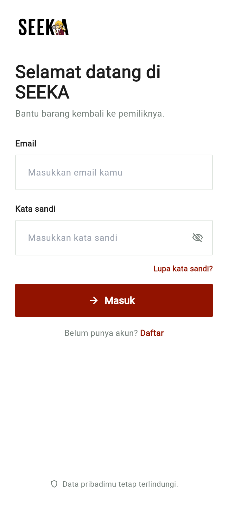
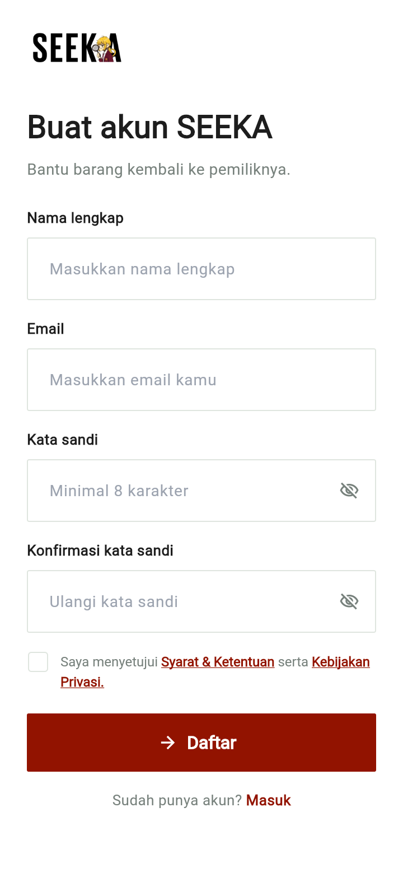
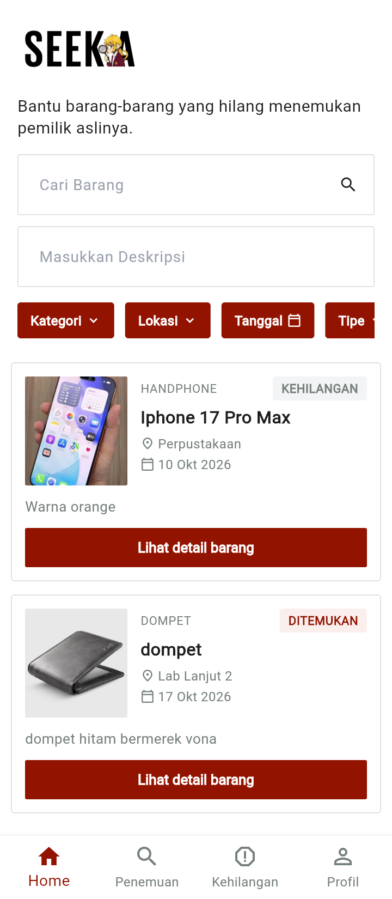
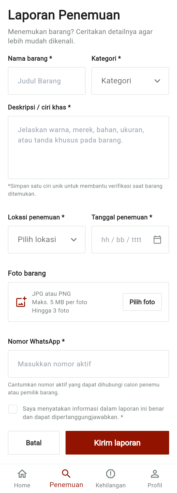
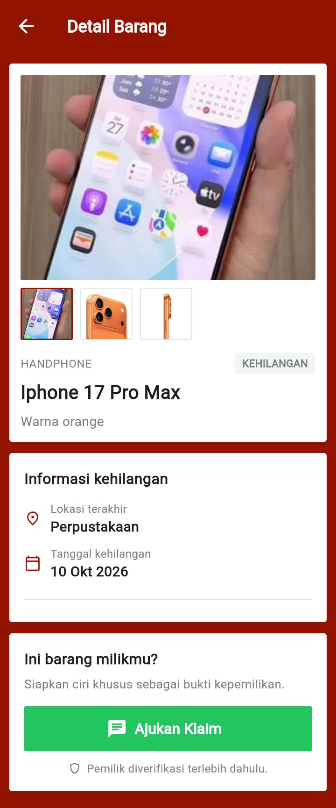
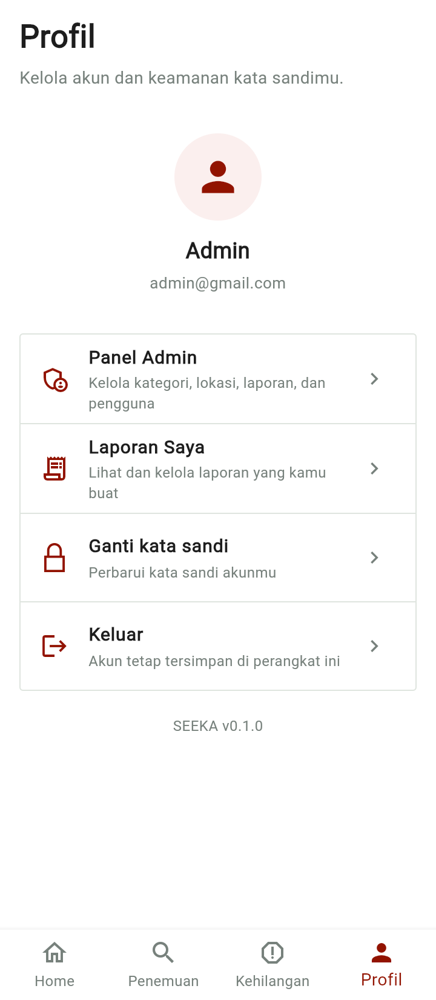
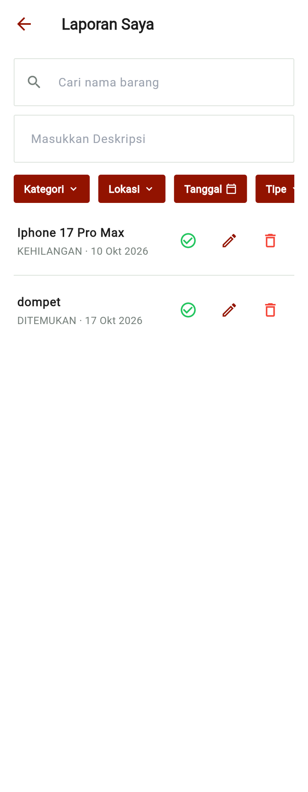
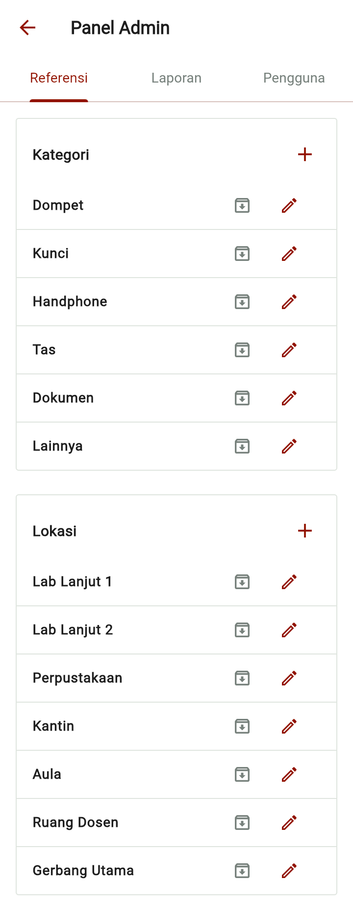
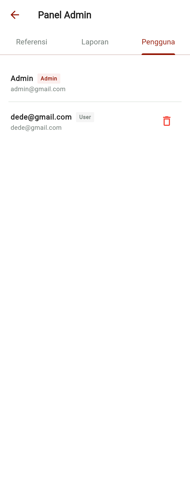

# SEEKA


**SEEKA** adalah aplikasi mobile berbasis Flutter untuk **pelaporan & pencarian barang hilang dan temuan**. Pengguna bisa membuat laporan *Penemuan* (menemukan barang) atau *Kehilangan* (kehilangan barang), mengajukan klaim, dan menghubungi pelapor langsung lewat WhatsApp. Admin dapat mengelola kategori, lokasi, seluruh laporan, dan akun pengguna.


## Fitur

- **Autentikasi** — login & registrasi, sesi tersimpan, dua role: `user` dan `admin`.
- **Beranda** — feed laporan, pencarian nama & deskripsi, filter **kategori, lokasi, rentang tanggal, dan tipe** (Ditemukan / Kehilangan / Diklaim).
- **Form laporan** — buat laporan Penemuan atau Kehilangan: nama barang, kategori, lokasi, tanggal, deskripsi/ciri khas, maksimal 3 foto, dan nomor WhatsApp; bisa **diedit** kembali.
- **Detail barang** — galeri foto, badge status, tombol **Ajukan Klaim** (berubah jadi "Barang sudah diklaim" setelah klaim), dan tombol **WhatsApp** ke pelapor (`wa.me`).
- **Laporan Saya** — kelola laporan milik sendiri: edit, hapus, tandai diklaim; lengkap dengan filter dan pencarian seperti panel admin.
- **Panel Admin** (khusus role admin, dibuka dari Profil):
  - **Referensi** — CRUD kategori & lokasi, tandai aktif/arsip.
  - **Laporan** — semua laporan, cari, filter, edit, hapus, toggle diklaim.
  - **Pengguna** — lihat & hapus akun.
- **Tampilan** — tema merah maroon, popup selalu putih, navigasi back via AppBar, bottom navigation: Home · Penemuan · Kehilangan · Profil (tab Penemuan/Kehilangan = form laporan).

## Menjalankan

```bash
flutter pub get
flutter run            # pilih device: Android / iOS / Chrome / desktop
```

- **Akun demo admin:** `admin@gmail.com` (tanpa password — field password jadi opsional untuk akun ini).
- Data awal (3 laporan demo, kategori & lokasi default) dimuat otomatis pada pertama kali dijalankan.

## Struktur Project

```
lib/
├── main.dart          # urutan init: Prefs → AuthStore → ReferensiStore → LaporanStore
├── app.dart           # MaterialApp + auth gate (login ↔ MainShell)
├── core/              # theme.dart, constants.dart, utils/ (formatters, foto_store)
├── data/              # prefs.dart, models.dart, + store ChangeNotifier:
│                      #   auth_store, referensi_store, laporan_store
├── features/
│   ├── auth/          # login, register
│   ├── home/          # beranda (search/filter in-place)
│   ├── report/        # form laporan, detail barang
│   ├── profile/       # profil, Laporan Saya
│   ├── admin/         # panel admin (Referensi/Laporan/Pengguna)
│   └── shell/         # bottom-nav MainShell
└── shared/            # app_image, app_logo, report_card, filter_sheet,
                       # lock_icon (widget reusable)
```

## Dependensi Utama

| Paket | Fungsi |
| --- | --- |
| `shared_preferences` | penyimpanan lokal (JSON) |
| `image_picker` | memilih foto dari galeri/kamera |
| `image` | kompres & encode foto (khusus web) |
| `flutter_svg` | render ikon SVG |
| `url_launcher` | membuka WhatsApp (`wa.me`) |
| `path_provider` | folder penyimpanan foto (mobile/desktop) |

State management memakai `ChangeNotifier` bawaan Flutter + `ListenableBuilder` — tanpa paket tambahan; navigasi pakai `Navigator`/`MaterialPageRoute` biasa.

## Catatan Web

- Foto di web disimpan sebagai **data URL base64 terkompres** (maks. 1024px) karena `dart:io` tidak tersedia di browser; penyimpanannya di `localStorage` (kuota ~5MB).
- Saat development web, gunakan port yang sama (mis. `flutter run -d web-server --web-port 8080`) supaya data tidak terlihat "hilang" (localStorage terikat origin/port).

## Tampilan Aplikasi

<sub>Login, daftar, dan sesi akun (admin & pengguna).</sub>

<table>
  <tr>
    <td width="50%" align="center">
      <br/>
      <sub><b>Login</b></sub>
    </td>
    <td width="50%" align="center">
      <br/>
      <sub><b>Daftar</b></sub>
    </td>
  </tr>
</table>

<sub>Beranda: pencarian + filter kategori, lokasi, tanggal, dan tipe.</sub>

<table>
  <tr>
    <td width="100%" align="center">
      <br/>
      <sub><b>Beranda</b> — pencarian + filter kategori, lokasi, tanggal, dan tipe</sub>
    </td>
  </tr>
</table>

<sub>Laporan: form penemuan/kehilangan dan detail barang.</sub>

<table>
  <tr>
    <td width="50%" align="center">
      <br/>
      <sub><b>Form Penemuan</b></sub>
    </td>
    <td width="50%" align="center">
      <br/>
      <sub><b>Form Kehilangan</b></sub>
    </td>
  </tr>
  <tr>
    <td width="100%" colspan="2" align="center">
      <br/>
      <sub><b>Detail Barang</b></sub>
    </td>
  </tr>
</table>

<sub>Profil, Laporan Saya, dan Panel Admin (khusus role admin).</sub>

<table>
  <tr>
    <td width="50%" align="center">
      <br/>
      <sub><b>Profil</b></sub>
    </td>
    <td width="50%" align="center">
      <br/>
      <sub><b>Laporan Saya</b></sub>
    </td>
  </tr>
  <tr>
    <td width="50%" align="center">
      <br/>
      <sub><b>Panel Admin — Referensi</b></sub>
    </td>
    <td width="50%" align="center">
      <br/>
      <sub><b>Panel Admin — Pengguna</b></sub>
    </td>
  </tr>
</table>
